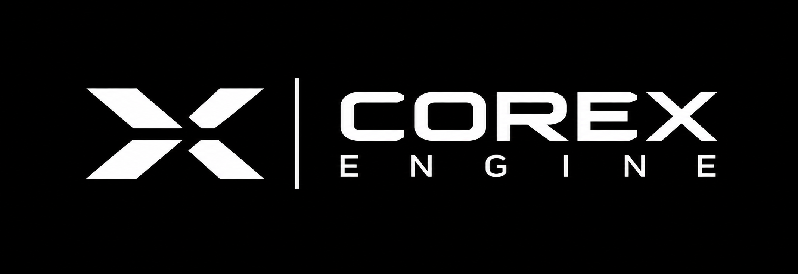

<p align="center">
  
</p>

<h1 align="center">CoreX Engine</h1>

<p align="center">
  <strong>A modular, Zig-based 3D game engine — currently validating its core architecture and headless runtime.</strong>
</p>

<p align="center">
  <a href="https://ziglang.org/"></a>
  <a href="https://en.wikipedia.org/wiki/C23_(C_standard_revision)"></a>
  <a href="#"></a>
</p>

---

## 📌 Overview

**CoreX** is an engine project in active development. The repository provides:

- **Independent Editor and Runtime bootstraps** for project validation.
- A shared **Core** library for lifecycle and subsystem ownership.
- A **Scene** library with entities, sparse-set components, systems, and scene lifecycle.
- Shared project contracts (`.proj` schemas, presets, identity).
- Native validation tooling and a separate legacy engine demonstration.

> **⚠️ Current product boundary:** Project validation and a deterministic headless fixed-step loop with an embedded smoke scene are implemented. Content-scene loading, a graphical Editor, playable Runtime, gameplay, and GPU presentation are **not yet available**.

> **📐 Product scope:** Windows and Linux; a 3D Editor with UI/Canvas, no 2D scene mode. Vulkan/OpenGL are planned on both platforms; D3D11/D3D12 are Windows-only. A platform being eligible does not mean its renderer is implemented. See [ADR-003](docs/ADR-003-desktop-3d-canvas.md).

---

## 🚦 Current Implementation Status

| Area | Status |
|------|--------|
| **Editor & Runtime** | Parse and validate project documents, presets, distribution identity, and the C23 graphics-configuration DTO. Runtime also runs a deterministic headless fixed-step loop (`--frames`) with an embedded smoke scene, reporting `entities_alive` and `state_checksum`. No content-scene loading, window, GPU device, or gameplay execution. Editor remains a validation bootstrap. |
| **Shared Contracts** | `.proj` schemas v1/v2/v3, preset validation, product identity, bootstrap protocol, and Zig↔C23 DTOs. See [`shared/README.md`](shared/README.md). |
| **Legacy Executable** | Independent demonstration using a null renderer. It is **not** the Editor or Runtime and does not prove GPU support. |
| **Graphics** | **No Vulkan Instance/Surface/Device/Swapchain or GPU presentation** in the applications. The pinned Zigway window dependency does not currently expose the native-window contract required by CoreX Vulkan. See [ADR-005](docs/ADR-005-vulkan-surface-integration.md). |

---

## 📋 Requirements

- **Zig 0.17.0** — do not silently substitute another version.
- A C compiler with **C23** support for shared and application builds.
- **Linux legacy window builds** require X11 development libraries (e.g., `libx11-dev` on Ubuntu). Headless tests do not open a display, but the legacy Zigway build still links X11.
- **Python** is still required by some CI and cross-process integration tests; see the [migration plan](docs/PYTHON_REMOVAL.md).

---

## 🛠️ Build & Validation

After Zig is available and the pinned legacy packages have been prepared:

```sh
zig build -j2 --summary all
zig build test --summary all
zig build test -Doptimize=ReleaseSafe --summary all
zig build validate -j2 --summary all
```

To install the supported Zig wheel on Linux without Python and prepare the pinned packages:

```sh
mkdir -p .cache
sh tools/install_zig.sh "$PWD/.cache/zig-0.17.0"
ZIG_EXE="$PWD/.cache/zig-0.17.0/ziglang/zig"
sh tools/prepare_legacy_deps.sh --zig "$ZIG_EXE"
"$ZIG_EXE" build validate -j2 --summary all
```

For offline dependency preparation, provide verified archives with `--archive-dir`, containing `zigway.tar.gz` and `zyntra_ui.tar.gz`. The preparation script verifies both archive checksums and package hashes before initializing Zig's cache. See [tooling documentation](tools/zig/README.md) for details.

> **⚠️ Note on cross-compilation:** `zig build check -Dtarget=x86_64-windows-gnu` is **compile-only**. It is not a native Windows runtime test. Do not report a cross-build as validation of native windowing, Vulkan, or GPU presentation.

---

## 📦 Applications & Components

| Component | Status & Documentation |
|-----------|------------------------|
| **Editor** | Project-validation bootstrap; no graphical UI or scene editing. [Build & usage](editor/README.md) |
| **Runtime** | Project-validation bootstrap + deterministic headless fixed-step loop with an embedded smoke scene; no content-scene loading, window, GPU, or gameplay execution. [Build & usage](runtime/README.md) |
| **Core** | Lifecycle and subsystem ownership shared by Editor and Runtime; no graphics, platform, ECS, or job system. [API & rules](core/README.md) |
| **Scene** | Generational entities, sparse-set components, generic World, deterministic Systems, and Scene lifecycle; depends only on Core. [API & rules](scene/README.md) |
| **Shared** | Schemas, presets, product identity, protocol, and C23 DTO. [Contracts & API](shared/README.md) |
| **Versioning CLI** | Validates and updates the root `VERSION`; does not create Git or GitHub releases. [Usage](versioning/README.md) |
| **Zig Tools** | Fixture, target-policy, dependency-preparation, and CI-capture tooling. [Usage](tools/zig/README.md) |

---

## 🔗 Pinned Legacy Integrations

The legacy build pins **Zigway v0.1.0-alpha.4** for window/input and **ZyntraUI v1.44.1** for UI-related experiments. CoreX's thin Zigway adapters have headless tests for explicit backend configuration, logical window lifecycle, event delivery, and input-state forwarding. These tests use Zigway's null backend; they do **not** exercise a native window or validate Vulkan.

Editor and Runtime are separate executables and do not currently share this legacy Engine or its window/UI integration. The dependency pins are not updated to an open, unvalidated Zigway branch.

---

## 📚 Project Contracts & Design Records

- [Contributing Guide](CONTRIBUTING.md)
- [Documentation Index](docs/README.md)
- [Application CLI & Protocol](docs/APPLICATION_CLI.md)
- [Application Layout](docs/APPLICATION_LAYOUT.md)
- [Application Progress & Evidence](docs/APPLICATION_PROGRESS.md)
- [Scene API & Rules](scene/README.md)
- [Project Schema v1](docs/PROJECT_SCHEMA_V1.md) · [v2](docs/PROJECT_SCHEMA_V2.md) · [v3](docs/PROJECT_SCHEMA_V3.md)
- [Preset Schema](docs/PRESETS_SCHEMA_V1.md)
- [Versioning Policy](VERSIONING.md) · [Changelog](CHANGELOG.md)
- [Example Project](exemploproject/README.md)

> The example document can be validated by the Editor, but its referenced scene and assets are **not loaded**. Project validation is not evidence of a working game, graphical Editor, or GPU renderer.

---

## 🗺️ Roadmap

- [ ] Content-scene loading in Runtime.
- [ ] Graphical Editor with UI/Canvas.
- [ ] Native window integration and Vulkan surface creation.
- [ ] GPU device and swapchain implementation.
- [ ] GPU presentation.
- [ ] Playable Runtime with gameplay execution.

---

## 🤝 Contributing

Contributions are welcome! Please read the [Contributing Guide](CONTRIBUTING.md) and the [Documentation Index](docs/README.md) before submitting a pull request.

---

<p align="center">
  <sub>Built with Zig 0.17.0 and C23.</sub>
</p>
```
